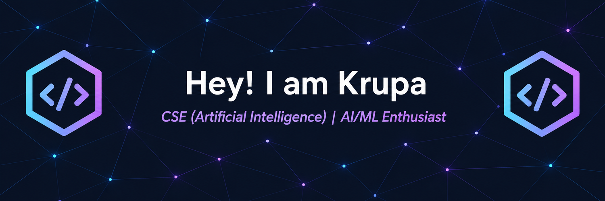

```html
<!-- ✨ HEADER BANNER -->

<p align="center">
  
</p>

<!-- 👋 INTRODUCTION -->

<h1 align="center">Heyy!!! I am Krupa 👋</h1>

<h3 align="center">
  CSE (Artificial Intelligence) Undergraduate | AI/ML Enthusiast
</h3>

<p align="center">
  <b>A curious mind at work, building things and learning along the way :)</b>
</p>

<!-- 💜 TAGLINE & PROFILE BADGES -->

<p align="center">
  <code>AI/ML + Intelligent Systems + Cloud Computing</code>
</p>

<p align="center">
  
  
  
</p>

---

## 🎓 Currently

**KLE Technological University**  
**Hubli, Karnataka**

CSE (Artificial Intelligence) student exploring **AI/ML, intelligent systems, data, software development, and cloud computing**.

Learning by **building • debugging • experimenting**.

---

## 🌱 About Me

I'm a CSE (AI) student who likes to build things that make me learn.

I'm constantly somewhere between **"I wonder how this works"** and **"okay, now let's make it work."**

My interests revolve around **AI/ML, intelligent systems, data, software development, and problem solving**.

I enjoy projects where there is more to solve than just writing code — understanding the problem, figuring out the architecture, trying different approaches, and debugging things that absolutely did not want to be debugged 😭

Most of my learning happens somewhere between a **terminal, a half-finished project, and far too many tabs open**.

I learn by **building, breaking, fixing, and trying again.**

---

## 💻 Interests

<p align="center">
  
  
  
  
  
  
</p>

---

## 🛠️ Technologies

<p align="center">
  
</p>

---

## 📌 Projects

### ☁️ Cloud Computing

**[CC-Experiment1-Hypervisor-Performance-Analysis](https://github.com/Krupa1310)**

Exploring hypervisors and virtual machine performance through benchmarking.

**[CC-Experiment-2-vm-vs-container-performance](https://github.com/Krupa1310)**

Comparing virtual machine and container performance using practical workloads.

### ⚡ Parallel & GPU Computing

**[PGC-Experiment-1-matrix-multiplication-lab](https://github.com/Krupa1310)**

Parallel computing experiment exploring matrix multiplication and performance.

---

## 📚 Currently Learning

<p align="center">
  
  
  
  
  
  
</p>

---

## 🌸 Learning via Building

<p align="center">
  <b>Build it. Break it. Debug it. Understand it. Repeat.</b>
</p>

---

## 📊 GitHub Stats

<p align="center">
  
  
</p>

---

## 🔥 Contribution Streak

<p align="center">
  
</p>

---

## 🔗 Connect With Me

<p align="center">
  <a href="https://github.com/Krupa1310">
    
  </a>
  <a href="https://www.linkedin.com/in/krupa-akki-995b02358/">
    
  </a>
</p>

---

<p align="center">
  ✨ <b>Thanks for visiting my profile!</b> ✨
</p>

<p align="center">
  <i>Always learning. Always building. 🚀</i>
</p>
```
